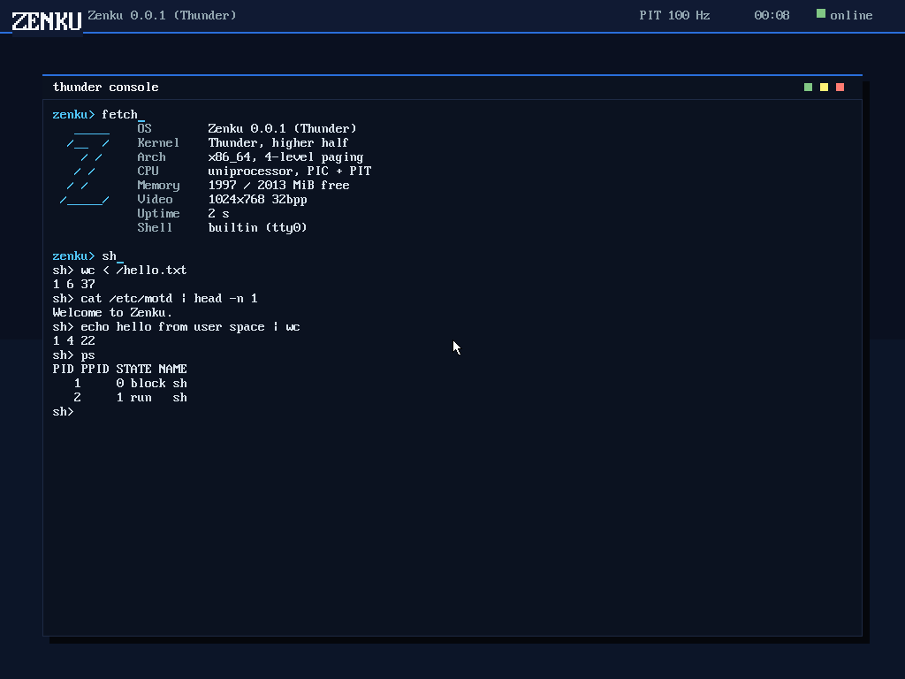
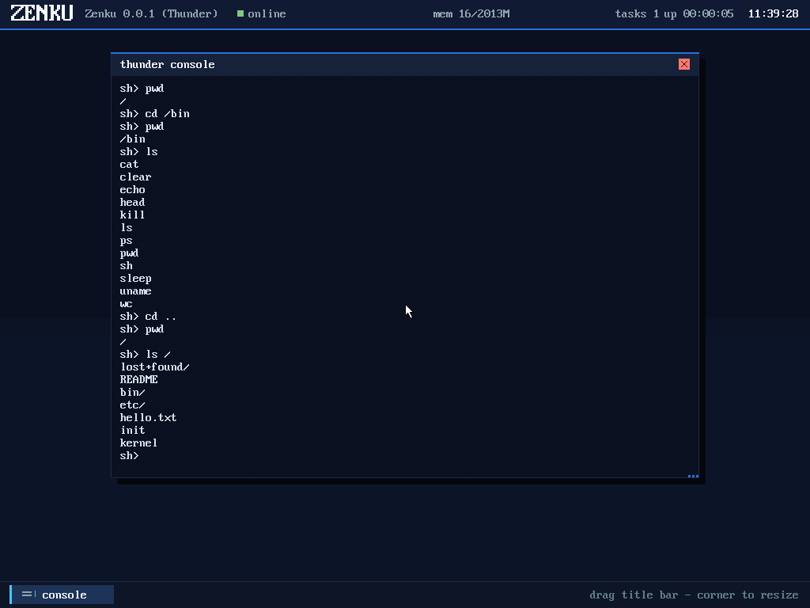
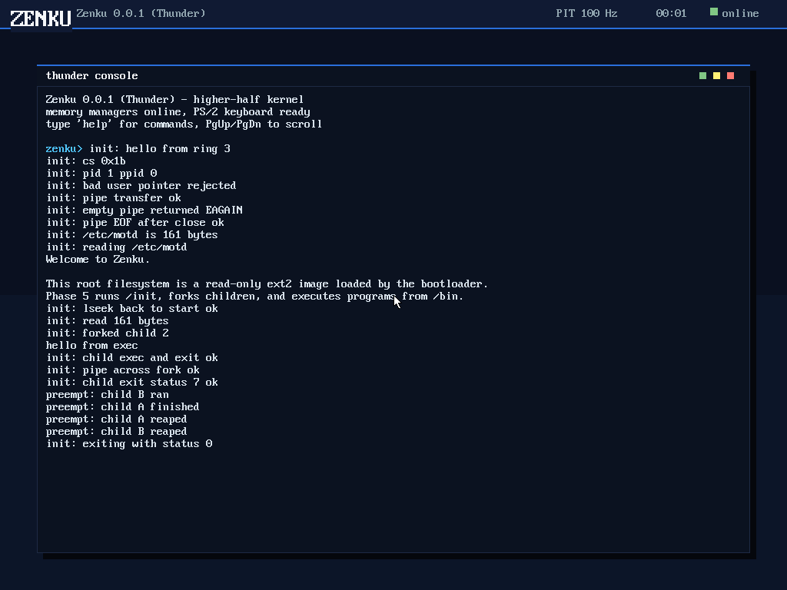
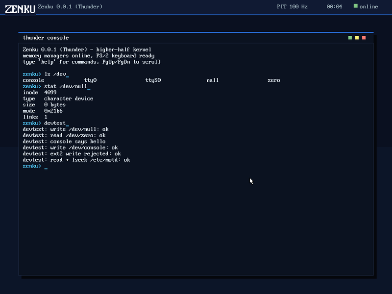

# Zenku

**A 64-bit Unix-like operating system, bootloader, and userland built from
scratch in C and x86_64 assembly.**

Zenku boots on BIOS PCs, runs a higher-half kernel with 4-level paging, and
provides a small Unix environment with an ext2 root filesystem, processes,
pipes, an interactive shell, and core utilities. The kernel codename is
**Thunder**.

[](LICENSE)
[](#)
[](#)
[](#)



## Overview

Zenku is a compact operating system written for learning and experimentation,
with production-style engineering discipline: every boot stage validates its
inputs, kernel memory is isolated, user pointers are checked at the syscall
boundary, and every subsystem is exercised by automated QEMU tests.

There is no GRUB, Limine, Multiboot, or borrowed kernel. The boot chain,
kernel, VFS, scheduler, shell, and core utilities are all part of this
repository. The result boots from a single `build/os.iso` image.

## Features

- **Custom BIOS boot chain** — El Torito stage1, E820/VBE/ISO9660 stage2, and
  a 64-bit stage3 loader that mounts ext2 and loads the kernel.
- **Higher-half kernel** — linked at `0xFFFFFFFF80000000`, 4-level paging,
  4 GiB direct map, 16 MiB kernel heap, and a bitmap physical frame allocator.
- **Fault-safe core** — GDT/TSS with double-fault IST, 256-entry IDT,
  readable panic dumps, and boot-time PMM/VMM/heap self-tests.
- **Filesystem and devices** — read-only ext2, a POSIX-style VFS, devfs under
  `/dev`, and 4 KiB pipes with `EAGAIN`, `EPIPE`, and EOF semantics.
- **Processes** — per-process page tables and 16 KiB kernel stacks, copy-on-write
  `fork`, `execve`, blocking `wait4`, and 100 Hz round-robin preemption.
- **Userland** — a freestanding ABI header, shared `crt0`, `/init`, `/bin/sh`
  with multi-stage pipelines, and `ls`, `cat`, `wc`, `ps`, `sleep`, `uname`,
  and `echo`.
- **Automated verification** — serial/PS2/QEMU integration tests for the boot
  chain, memory, filesystem, syscalls, scheduler, shell, and fault paths.

## Screenshots

| Interactive shell | Scheduler and processes | ext2 and devfs |
|:---:|:---:|:---:|
|  |  |  |

## Architecture

```
BIOS / SeaBIOS
  └─ stage1        El Torito boot image, real-mode loader
      └─ stage2    E820, VBE, ISO9660, loads stage3 and rootfs
          └─ stage3  long mode, ext2, ELF64, page tables
              └─ Thunder kernel
                  ├─ memory: PMM, VMM, heap
                  ├─ storage: ext2, VFS, devfs, pipes
                  ├─ execution: ELF loader, syscalls, user copies
                  └─ processes: scheduler, COW fork, exec, wait
```

| Region | Virtual address | Purpose |
|---|---|---|
| User space | `0x0000000000400000` | ELF images and user stacks |
| Direct map | `0xFFFF800000000000` | 4 GiB physical memory window |
| Kernel image | `0xFFFFFFFF80000000` | Kernel text, data, and BSS |
| Kernel heap | `0xFFFFFFFFA0000000` | 16 MiB general-purpose heap |

## Getting started

### Requirements

A Linux host with a C compiler and binutils, plus:

| Tool | Purpose |
|---|---|
| `nasm` | Bootloader and kernel assembly |
| `xorriso` | ISO image creation |
| `mke2fs` / `e2fsprogs` | Root filesystem image |
| `qemu-system-x86_64` | Emulation and integration tests |
| `make`, `bash`, coreutils | Build and test scripts |

A real `x86_64-elf` cross toolchain is optional. The build falls back to the
host compiler with freestanding flags.

```sh
make toolchain                 # optional: install to ~/.local/cross
source ~/.local/cross/env.sh   # put x86_64-elf-* on PATH
```

### Build and run

```sh
make          # build build/os.iso
make run      # boot in a graphical QEMU window, serial on stdio
make debug    # boot with a QEMU GDB stub (-s -S)
```

`make run` uses 2 GiB of RAM and mirrors kernel diagnostics to the terminal
over COM1.

### Tests

```sh
make test         # headless boot and serial assertions
make test-faults  # inject #DE/#UD/#GP/#PF and verify panic handling
make test-input   # PS/2 keyboard and mouse path
make test-serial  # COM1 receive over IRQ4
make test-fs      # ext2, VFS, and devfs
make test-user    # ring-3 entry, syscalls, and user copies
make test-proc    # fork, exec, wait, pipes, preemption, COW
make test-sh      # shell builtins, coreutils, and pipelines
make check        # fast C/assembly/shell/Python syntax checks
make check-link   # syntax checks plus stage3 and kernel link checks
make layout       # validate the boot image layout
make doctor       # report toolchain and dependency status
```

## Using Zenku

The kernel console accepts `help`, `fetch`, `mem`, `ticks`, `uptime`,
`version`, `clear`, `colors`, `ls`, `cat`, `stat`, `devtest`, `init`, `sh`,
and `ps`.

`sh` starts the userland shell. It supports `exit`, `help`, and `pwd`
builtins, external programs in `/bin`, and pipelines of up to four stages:

```text
sh> ls /
sh> cat /hello.txt
sh> echo hello from user space | wc
sh> sleep 1
sh> ps
```

The root filesystem is intentionally read-only; writes are rejected by the
VFS and ext2 layer.

## Repository layout

```
boot/       stage1, stage2, and stage3 boot chain
kernel/     higher-half kernel: arch, memory, filesystem, scheduler, syscalls
drivers/    PIC, PIT, PS/2, mouse, and serial drivers
fs/         shared ext2 implementation used by stage3 and the kernel
libc/       freestanding user-space ABI and headers
user/       crt0, init, shell, and coreutils
docs/       plan, boot protocol, and screenshots
linker/     kernel, stage3, and user linker scripts
scripts/    build, image, rootfs, and test tooling
tests/      host and QEMU integration test sources
```

## Documentation

- [`docs/PLAN.md`](docs/PLAN.md) — architecture, phase plan, and design notes
- [`docs/boot-protocol.md`](docs/boot-protocol.md) — boot media and `boot_info` ABI

## Contributing

Issues and pull requests are welcome. Before submitting a change:

```sh
make check
make check-link
make test
```

Keep patches focused, match the surrounding C style, and update the relevant
documentation when behavior changes.

## License

MIT. See [`LICENSE`](LICENSE).
